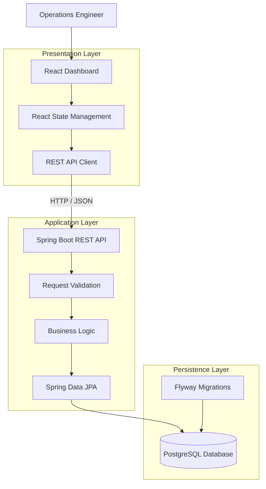
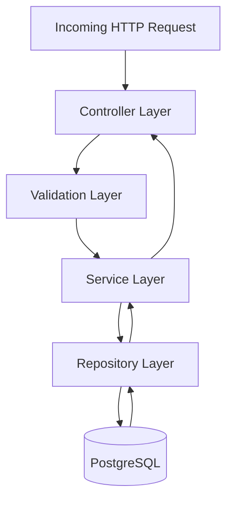
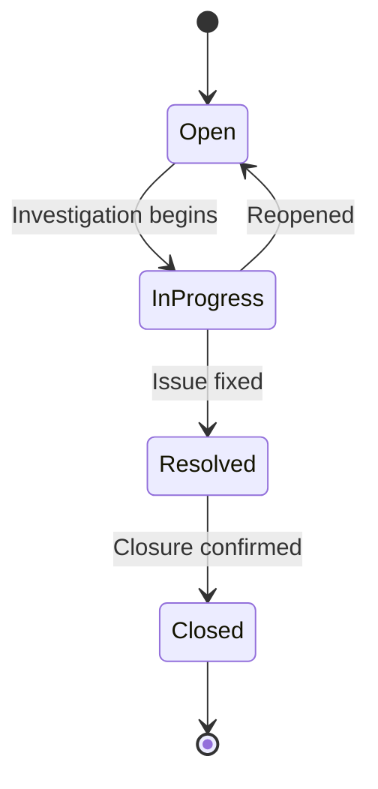
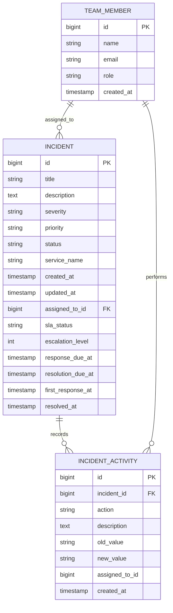
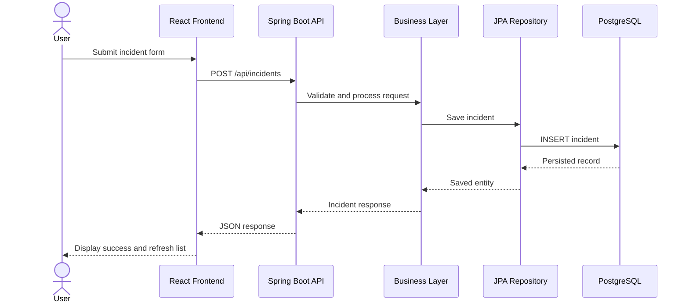
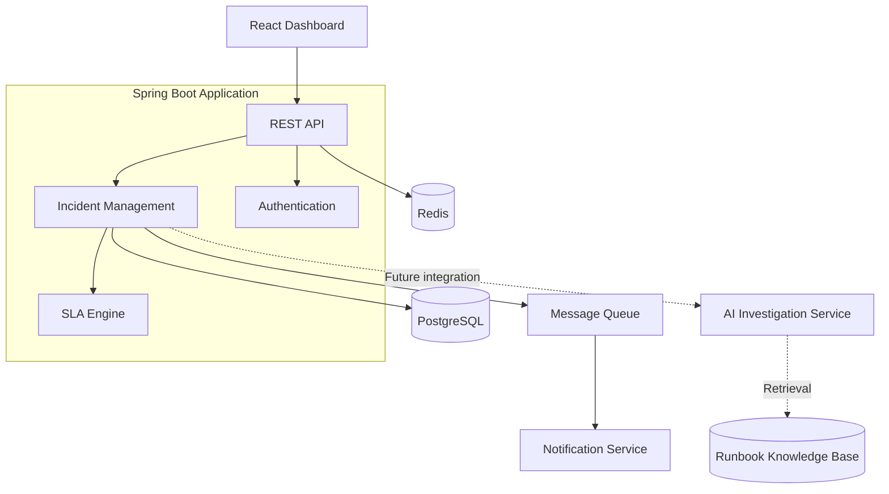

# ⚡ OpsPilot AI
### Incident Intelligence & IT Operations Management Platform

<p align="center">
  <strong>A centralized platform for incident tracking, operational visibility, team coordination, and SLA management.</strong>
</p>

<p align="center">
  
  
  
  
  
  
</p>

---

## 📌 Overview

**OpsPilot AI** is an incident management and IT operations platform designed to help engineering and operations teams manage incidents through a centralized dashboard.

It provides a structured workflow for reporting incidents, assigning responsibility, monitoring resolution progress, tracking service-level agreements (SLAs), and maintaining an activity history.

Instead of relying on scattered communication and manual incident tracking, OpsPilot provides a unified interface for operational visibility and coordination.

### Core Objectives

- Centralize incident reporting and management.
- Prioritize incidents based on severity and business urgency.
- Improve accountability through team assignments.
- Track response and resolution deadlines.
- Maintain a chronological history of incident activities.
- Provide a foundation for future AI-assisted incident intelligence.

---

## ✨ Features

### 1. Incident Management
- Create and manage incidents.
- Record incident titles and descriptions.
- Associate incidents with affected services.
- Track incident severity and priority.
- Monitor incident status.

### 2. Priority-Based Incident Tracking

Incidents support four priority levels:

| Priority | Description |
|---|---|
| Critical | Requires immediate attention |
| High | Requires urgent investigation |
| Medium | Standard operational priority |
| Low | Can be handled during normal operations |

### 3. Team Assignment
- Assign incidents to team members.
- Retrieve team member information.
- Track assignment changes.
- Improve ownership and accountability.

### 4. SLA Monitoring

Track operational deadlines using:

- Response deadlines.
- Resolution deadlines.
- First response timestamps.
- Resolution timestamps.

SLA states:

| State | Meaning |
|---|---|
| ON_TRACK | Within the defined SLA |
| AT_RISK | Approaching the deadline |
| BREACHED | SLA deadline exceeded |
| COMPLETED | Incident resolved |

### 5. Incident Activity Timeline

Maintain an activity history containing:

- Incident updates.
- Status changes.
- Assignment changes.
- Previous and updated values.
- Activity timestamps.

### 6. Incident Filtering and Search

Filter incidents using:

- Text search.
- Severity.
- Priority.
- Status.

Incidents are also sorted by priority to help operators identify important issues.

---

# 🏗️ System Architecture

OpsPilot follows a **three-layer client-server architecture**.

The frontend handles presentation and user interaction, the backend manages business logic and REST APIs, and PostgreSQL provides persistent storage.

## 1. High-Level Architecture



### Architecture Responsibilities

| Layer | Responsibility |
|---|---|
| Presentation | Dashboard, forms, filtering and user interactions |
| API | HTTP endpoints and request/response handling |
| Validation | Input validation and request constraints |
| Business | Incident management and workflow rules |
| Persistence | Entity management and database operations |
| Database | Durable storage of application data |
| Migration | Version-controlled database schema changes |

## 2. Backend Architecture

The backend uses Spring Boot and follows a layered architecture.



**Responsibilities:**

- Controller: Exposes REST endpoints.
- Validation: Validates incoming request data.
- Service: Contains application and business rules.
- Repository: Handles database access through Spring Data JPA.
- Entity: Represents persistent domain objects.

This separation keeps HTTP handling, business rules, and persistence concerns independent.

## 3. Incident Lifecycle

The following diagram illustrates the intended operational workflow.



The exact status values and permitted transitions should follow the backend implementation.

---

# 🗄️ Database Design

PostgreSQL is used as the primary relational database.

Spring Data JPA provides object-relational mapping, while Flyway manages database schema migrations.

## 1. Core Data Model

The following is a logical representation of the domain objects exposed by the application.



*Note: This is a logical data model based on the frontend API contracts, not a verified SQL schema.*

## 2. Data Relationships

- A team member can be assigned multiple incidents.
- An incident can have multiple activity records.
- Each activity belongs to an incident.
- Incident records contain priority, severity, status and SLA information.

## 3. Database Design Principles

- Relational integrity through primary and foreign keys.
- Consistent entity relationships.
- Schema versioning using Flyway.
- Database validation through Hibernate.
- Persistent incident and activity records.

---

# 🔄 Application Request Flow

Example: Creating an incident.



### Request Processing

1. The user submits an incident through the React dashboard.
2. The frontend sends an HTTP request containing JSON.
3. Spring Boot receives and validates the request.
4. The business layer processes the incident.
5. Spring Data JPA persists the record.
6. PostgreSQL stores the incident.
7. The backend returns the created incident.
8. The frontend refreshes the incident list.

---

# 🔌 API Reference

Base URL:

```text
http://localhost:8080/api
```

## Incident APIs

| Method | Endpoint | Description |
|---|---|---|
| GET | `/incidents` | Retrieve incidents |
| POST | `/incidents` | Create an incident |
| PATCH | `/incidents/{id}/status` | Update incident status |
| GET | `/incidents/{id}/activities` | Retrieve activity history |
| PATCH | `/incidents/{id}/assign` | Assign an incident |

## Team APIs

| Method | Endpoint | Description |
|---|---|---|
| GET | `/team-members` | Retrieve team members |

### Example: Create Incident

**POST** `/api/incidents`

Request:

```json
{
  "title": "Payment Service Failure",
  "description": "Payment requests are returning HTTP 500 errors.",
  "severity": "HIGH",
  "priority": "HIGH",
  "serviceName": "Payment Service"
}
```

### Example: Update Incident Status

**PATCH** `/api/incidents/1/status`

```json
{
  "status": "IN_PROGRESS"
}
```

### Example: Assign an Incident

**PATCH** `/api/incidents/1/assign`

```json
{
  "teamMemberId": 2
}
```

---

# 🛠️ Technology Stack

## Frontend

| Technology | Purpose |
|---|---|
| React 19 | Component-based UI |
| TypeScript | Static type safety |
| Vite | Development server and build tooling |
| CSS | Responsive styling |
| Fetch API | Backend communication |

## Backend

| Technology | Purpose |
|---|---|
| Java 21 | Backend programming language |
| Spring Boot | Application framework |
| Spring WebMVC | REST API development |
| Spring Data JPA | Database interaction |
| Hibernate | ORM |
| Jakarta Validation | Input validation |
| Spring Boot Actuator | Application monitoring |
| Flyway | Database migrations |

## Database

| Technology | Purpose |
|---|---|
| PostgreSQL | Relational database |

---

# 🚀 Getting Started

## Prerequisites

Install the following:

- Java Development Kit 21
- Node.js and npm
- PostgreSQL
- Maven (or use the Maven Wrapper if available)
- Git

## 1. Clone the Repository

```bash
git clone https://github.com/karanjot140506/opspilot-ai.git

cd opspilot-ai
```

## 2. Configure PostgreSQL

Create the database and user:

```sql
CREATE USER opspilot WITH PASSWORD 'your_password';

CREATE DATABASE opspilot OWNER opspilot;
```

Ensure PostgreSQL is running on port `5432`.

## 3. Configure the Backend

Navigate to the backend:

```bash
cd backend
```

Set the database password.

**Linux/macOS:**

```bash
export DB_PASSWORD=your_password
```

**Windows PowerShell:**

```powershell
$env:DB_PASSWORD="your_password"
```

The application configuration uses:

```properties
spring.application.name=backend

spring.datasource.url=jdbc:postgresql://localhost:5432/opspilot
spring.datasource.username=opspilot
spring.datasource.password=${DB_PASSWORD}

spring.jpa.hibernate.ddl-auto=validate
spring.jpa.open-in-view=false
```

## 4. Start the Backend

```bash
mvn spring-boot:run
```

The backend should be available at:

```text
http://localhost:8080
```

## 5. Start the Frontend

Open another terminal:

```bash
cd frontend
```

Install dependencies:

```bash
npm install
```

Start the development server:

```bash
npm run dev
```

Open the local URL printed by Vite, typically:

```text
http://localhost:5173
```

---

# 📁 Project Structure

The following is a high-level logical view of the repository.

```text
opspilot-ai/
│
├── backend/
│   ├── pom.xml
│   └── src/
│       ├── main/
│       │   ├── java/
│       │   │   └── .../
│       │   │       ├── controller/
│       │   │       ├── service/
│       │   │       ├── repository/
│       │   │       ├── entity/
│       │   │       └── dto/
│       │   │
│       │   └── resources/
│       │       ├── application.properties
│       │       └── db/migration/
│       │
│       └── test/
│
├── frontend/
│   ├── package.json
│   ├── vite.config.ts
│   └── src/
│       ├── api/
│       │   └── incidents.ts
│       ├── App.tsx
│       ├── App.css
│       ├── main.tsx
│       └── index.css
│
└── README.md
```

---

# 🔐 Engineering Considerations

The following are recommended considerations for a production deployment.

| Area | Recommended practice |
|---|---|
| Authentication | Spring Security with JWT or OAuth2 |
| Authorization | Role-based access control |
| Database | Indexed queries and connection pooling |
| API security | Input validation and rate limiting |
| Configuration | Environment-based secrets |
| Observability | Actuator, structured logs and metrics |
| Reliability | Database backups and health checks |
| Testing | Unit, integration and API tests |

Never commit database passwords, API keys, or other sensitive credentials to version control.

---

# 📈 Scalability and Future Architecture

OpsPilot currently uses a straightforward client-server architecture.

As operational requirements increase, the architecture can evolve incrementally.

Potential improvements:

1. **Authentication and RBAC:** Introduce secure operator identities and permissions.
2. **Notification Service:** Add email or messaging notifications for critical incidents.
3. **Background Processing:** Use a message queue for asynchronous incident events.
4. **Caching:** Introduce Redis for frequently accessed data.
5. **Observability:** Add distributed tracing, centralized logs and dashboards.
6. **AI-Assisted Investigation:** Introduce an evidence-grounded AI layer for incident summaries and root-cause suggestions.
7. **Knowledge Retrieval:** Integrate runbooks and historical incidents for contextual recommendations.

## Potential Future Architecture



*This is a proposed evolution, not a description of currently deployed services.*

---

# 🧪 Testing

Recommended testing strategy:

- Unit tests for business logic.
- Repository integration tests.
- REST API tests.
- Frontend component tests.
- End-to-end incident lifecycle tests.
- SLA boundary and escalation tests.

Backend:

```bash
cd backend
mvn test
```

Frontend:

```bash
cd frontend
npm run build
npm run lint
```

---

# 🗺️ Roadmap

- [x] Incident creation and tracking
- [x] Severity and priority management
- [x] Team member assignment
- [x] Incident activity history
- [x] SLA tracking fields and status
- [x] Escalation tracking
- [x] Incident search and filtering
- [ ] Authentication and authorization
- [ ] Automated incident notifications
- [ ] Advanced operational analytics
- [ ] AI-assisted root-cause analysis
- [ ] Runbook-based recommendations
- [ ] Automated incident insights

---

# 🤝 Contributing

Contributions are welcome.

1. Fork the repository.
2. Create a feature branch.
3. Implement your changes.
4. Run the relevant tests.
5. Submit a pull request with a clear description.

```bash
git checkout -b feature/your-feature
```

---

# 📄 License

Add the appropriate license information here before distributing the project.

---

<p align="center">
  <strong>OpsPilot AI</strong><br/>
  Building better incident management workflows.
</p>
